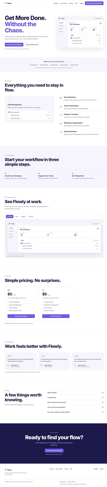

# Flowly: Dummy SaaS Landing Page

Landing page dummy untuk produk fiktif **Flowly**, dibangun dengan Vite + React. Proyek ini dibuat sebagai contoh portofolio: semua logo, angka, testimoni, harga, dan akun diberi label demo, bukan klaim pelanggan nyata.

## Screenshot



## Menjalankan proyek

```bash
npm install
npm run dev
```

Buka `http://localhost:5173`.

Build produksi:

```bash
npm run build
npm run preview
```

## Struktur

```
src/
  App.jsx                     susunan section
  i18n/index.jsx              dictionary ID/EN + LanguageProvider + useLanguage
  styles.css                  sistem warna, tipografi, layout, responsive
  components/
    Navbar.jsx                navigasi + menu mobile + dialog login + sakelar bahasa
    LanguageSwitcher.jsx      dua tombol bendera SVG (ID / EN)
    MotionProgress.jsx        garis progres baca (Framer Motion)
    MotionHeadline.jsx        stagger kata pada headline
    Hero.jsx
    DashboardMockup.jsx       mockup UI yang dibangun dengan CSS
    SocialProof.jsx           placeholder logo, diberi label demo
    Features.jsx              satu fitur unggulan + lima fitur ringkas
    HowItWorks.jsx            tiga langkah, tanpa ikon bulat templat
    ProductPreview.jsx        empat tab sungguhan dengan AnimatePresence
    Pricing.jsx               dua tier, setara
    Testimonials.jsx          kutipan contoh dengan label Example
    FAQ.jsx                   accordion satu terbuka, keyboard friendly
    FinalCTA.jsx              tombol membuka dialog demo
    Footer.jsx                tautan + dialog kebijakan
    InfoDialog.jsx            dialog dengan Escape dan focus return
    Icon.jsx                  ikon SVG custom
    Mark.jsx                  motif tiga garis
    Reveal.jsx                scroll reveal dengan fallback
public/
  fonts/inter-latin.woff2     Inter self-hosted
  favicon.svg
  robots.txt
  sitemap.xml                 domain contoh, ganti saat deploy
docs/
  flowly-desktop.jpg
DESIGN.md                     arah desain dan alasan setiap adaptasi antislop
```

## Dua bahasa

Halaman bisa ditampilkan dalam **Indonesia** dan **English** lewat sakelar bendera di header.

- Bahasa awal: Indonesia. Pilihan tersimpan di `localStorage` dengan kunci `flowly-language`, jadi tetap bertahan setelah refresh.
- Sakelar memakai dua tombol dengan `aria-pressed`, bukan dropdown. Bendera digambar sebagai SVG inline, bukan emoji, supaya konsisten dengan aturan ikon dan tampil sama di semua sistem.
- Mengganti bahasa juga memperbarui `document.documentElement.lang`, `document.title`, meta description, dan tag OG.
- Seluruh teks UI berasal dari dictionary di `src/i18n/index.jsx`. Tidak ada string hardcoded di komponen, termasuk judul headline, label tab, teks mockup, dialog, dan skip link.
- Label angka dan struktur halaman tidak berubah, jadi layout tidak bergeser saat bahasa diganti.

## Interaksi yang tersedia

- Sakelar bahasa ID/EN di header. Fokus keyboard dan status aktif dibaca pembaca layar.
- Menu mobile buka/tutup, Escape menutup.
- Dialog Log in, signup, Privacy Policy, dan Terms of Service, Escape menutup dan fokus kembali ke tombol.
- Empat tab product preview, bisa dipindah dengan Tab, Arrow Left, dan Arrow Right.
- Checkbox pada view Tasks bisa dicentang.
- Accordion FAQ hanya membuka satu item, ditutup dengan klik lagi.
- Smooth scroll, stagger headline, progress baca, dan scroll reveal.
- CTA utama hero dan final CTA mengikuti kursor, lalu kembali saat ditinggalkan.
- Garis waktu How It Works menggambar saat section masuk viewport, progress bar terisi saat tab Progress dibuka, centangan Tasks muncul dengan animasi pop, dan kartu feature/pricing/testimoni angkat saat di-hover.
- Semua gerak dimatikan atau dipendekkan pada `prefers-reduced-motion: reduce`. Tidak ada loop tanpa henti.

## Adaptasi antislop terhadap PRD

PRD meminta beberapa pola yang dilarang oleh aturan antislop. Sesuai keputusan session, isi PRD dipenuhi tetapi polanya disesuaikan:

| Permintaan PRD | Adaptasi | Alasan |
| --- | --- | --- |
| Soft purple gradient | Satu warna violet solid | Gradient biru/ungu adalah default AI dan menghapus hierarki |
| Get Started, Explore Features | Create your free workspace, See how Flowly works | CTA menyebut tindakan dan objeknya |
| Em dash pada subheadline | Diganti titik | Aturan hard gate R-02 |
| How It Works 3 langkah berikon bulat | Garis waktu tipografis bernomor | Proses tetap 3 langkah, bentuk templat dihilangkan |
| Footer 4 kolom | Dua area: identitas dan satu baris tautan | Tidak cukup tautan nyata untuk 4 kolom |
| Logo dan statistik pelanggan | `[Logo demo]`, `[Demo user count]` | Tidak ada pelanggan nyata |
| Testimoni fictional | Inisial, label Example, tanpa foto AI | Tidak ada orang nyata yang dikutip |

Detail lengkap ada di `DESIGN.md`.

## Verifikasi

- `npm run build`: berhasil, tanpa error.
- Console browser: nol error dan nol warning.
- Klik-through: semua tautan navigasi, menu mobile, empat dialog, empat tab preview, checkbox Tasks, dan accordion FAQ berfungsi.
- Dua bahasa: toggle ID/EN mengubah seluruh teks, `html lang`, judul, dan meta description; pilihan bertahan setelah refresh; fokus keyboard masih bisa menjangkau kedua tombol.
- Lighthouse di jalur dev: Accessibility 100, Best Practices 100, SEO 100, tanpa failure.
- Mobile 390 px: tidak ada horizontal overflow, menu dan CTA terlihat.
- Lighthouse performance **tidak diukur** di lingkungan ini karena alat audit yang dipakai tidak menjalankan benchmark performa. Target 90+ perlu diverifikasi pada build produksi yang di-deploy.

## Catatan deployment

Ganti `contoh.local` di `public/sitemap.xml` dan `public/robots.txt` dengan domain asli. Ganti OG image di `index.html` dengan aset yang benar-benar ada.
